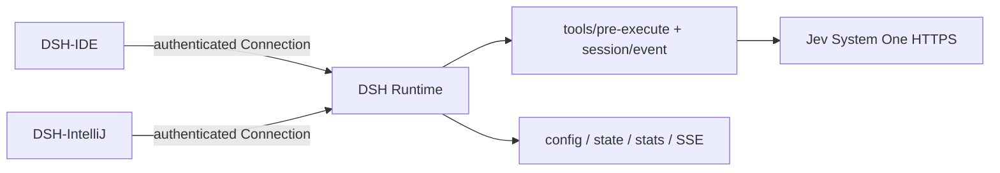

<h1 align="center">DSH Jev Runtime Integration</h1>

<p align="center">
  <strong>One shared Jev Runtime layer for DSH-IDE and DSH-IntelliJ.</strong><br>
  Keep Jev configuration, hooks, state, and protocol in the Runtime that both IDEs can use.
</p>

<p align="center">
  <strong>English</strong> | <a href="README.zh-CN.md">简体中文</a>
</p>

<p align="center">
  <em>An IDE-neutral DSH integration package. No VS Code UI, IntelliJ UI, or IDE SDK is included.</em>
</p>

## Why this repository?

- **One Runtime integration.** DSH-IDE and DSH-IntelliJ pin the same repository commit under `vendor/dsh-jev-integration`.
- **Real Jev calls.** The adapter follows the local `dsh-jev` 0.2.0 System One HTTP contract instead of inventing a client SDK.
- **Runtime-owned state.** Configuration, effective state, statistics, hooks, and subscriptions live beside the DSH Runtime rather than in either IDE.
- **Safe reuse.** Existing Runtime connections are probed before use; disconnecting one IDE only removes its subscriptions and never stops a shared Runtime.

The implementation was checked against the local DSH sources in
`../dsh-ide/deepseek-harness` and the Jev source checkout in
`/tmp/dsh-jev-research` at commit `b672902`. The DSH compatibility floor is
`0.1.5-rc.2`.

## Quick start

This repository is for host/plugin developers. End users install their IDE
plugin; they do not install a Jev IDE plugin.

Requirements: Node.js `>=22.19.0`, a DSH Runtime `>=0.1.5-rc.2`, and an
optional `TYPESAFE_API_KEY` when Jev advisory checks are desired.

1. Pin this repository to the commit selected by both hosts.
2. Build the package:

   ```bash
   pnpm install
   pnpm build
   pnpm typecheck
   pnpm smoke
   ```

3. Add the package to the DSH profile owned by the IDE:

   ```bash
   dsh plugin --profile <profile-name> add /absolute/path/dsh-jev-integration
   ```

4. Provide `TYPESAFE_API_KEY` to that Runtime, or use the existing
   `$HOME/.dsh/.env` convention. The key is never returned by the protocol or
   persisted by this package.
5. On every attach or reconnect, call
   `GET /api/dsh-jev/capabilities` and compare the integration/protocol version,
   reported commit, Runtime compatibility, and required capabilities before
   subscribing to state.

### Try it on a Runtime

| Need | Start with |
| --- | --- |
| Check whether the plugin is mounted | `GET /api/dsh-jev/capabilities` |
| Read the resolved configuration | `GET /api/dsh-jev/config?workspaceId=...` |
| Override only the next DSH turn | `POST /api/dsh-jev/config` with `scope: "next-turn"` |
| Render live Runtime state | `GET /api/dsh-jev/events?workspaceId=...` |
| Inspect measured Jev calls | `GET /api/dsh-jev/stats?workspaceId=...` |

## Features

### Real Jev System One adapter

`runtime/src/jev-client.ts` sends the same request shape used by the local
`dsh-jev` source: `model`, stringified `state`, and `questions` containing the
real `noul` and `score` question forms. It accepts `answers`, `results`, and
direct answer objects, and normalizes the actual `noul`/`probability` fields.

The default endpoint is `https://api.typesafe.ai/v1/systemone`, the default
model is `jev-latest`, and the client reads `TYPESAFE_API_KEY` or
`$HOME/.dsh/.env`. No Jev binary, model weights, platform resource, or IDE
plugin is bundled.

### DSH Runtime hooks and exact endpoints

The Cordis plugin registers the real DSH `tools/pre-execute` hook for guarded
tools and the durable `session/event` hook for one-shot next-turn overrides.
Communication uses DSH Connection exact Fetch routes; this repository does not
add a second RPC or WebSocket stack.

The package exposes:

- `GET /api/dsh-jev/capabilities`
- `GET` and `POST /api/dsh-jev/config`
- `GET /api/dsh-jev/state`
- `GET /api/dsh-jev/stats`
- `POST /api/dsh-jev/stats/reset`
- `GET /api/dsh-jev/events` (SSE)

DSH's exact Fetch registry supports GET/HEAD/POST, so configuration updates are
POST requests rather than an invented PUT endpoint.

### Optional, fail-open advisory checks

Jev is an enhancement, not a replacement for DSH permission and safety
policies. Missing credentials, timeouts, cancellation, network/HTTP failures,
and malformed answers are counted and exposed through Runtime state, then the
normal DSH tool pipeline continues. A valid Jev result can return `ask` or
`deny` according to the configured thresholds; the host/DSH Runtime owns the
headless `ask` behavior.

### Shared state and lifecycle

The plugin is idempotent within one Runtime scope. It avoids duplicate hooks,
routes, and statistics. It supports a Runtime started by an IDE, an existing
Runtime, two simultaneous IDE clients, disconnect/reconnect, and plugin unload
or remount. It does not dynamically mount into or restart a Runtime that the
host does not own.

## FAQ

**Do I need to install a Jev IDE plugin?** No. The IDE plugin only mounts this
package into a Runtime and consumes its protocol. The Runtime makes the HTTPS
System One request.

**What is a `workspaceId`?** It is the DSH Workspace identity resolved from
`session.header.cwd` through `workspaceRegistry`. It is not an IDE project
directory identifier. If a hook cannot resolve a DSH Workspace, it does not
invent one and lets the normal DSH pipeline continue.

**Can I connect to an existing or remote Runtime?** Yes. Probe capabilities
first. If the endpoint is missing or incompatible, show that result to the user
and ask the owner of that Runtime to mount a compatible package. This package
does not assume dynamic mounting, restart, or configuration authority over a
foreign Runtime.

**What happens without an API key?** The default requested state remains
`enabled=true`, but Runtime state reports `available=false` with
`missing-api-key`. Normal DSH conversations are not blocked.

**Where is configuration persisted?** Global and workspace values are stored
under `$DSH_HOME/jev-integration/` (`config.json` and `stats.json`).
`DSH_JEV_INTEGRATION_HOME` is an explicit test/deployment override. Session and
next-turn values are memory-only.

**How does a next-turn override work?** A `scope: "next-turn"` write is tied to
one DSH session and is consumed exactly once by that session's durable
`session/event` with `type: "turn/start"`. It is not consumed by an arbitrary
IDE event.

**Does disconnecting one IDE stop Jev for another?** No. The disconnect only
removes that client's SSE subscription. Shared Runtime services and persisted
state remain available to other clients.

## Architecture and runtime



The runtime package is intentionally split into two stable surfaces:

```
dsh-jev-integration/
  runtime/       Cordis plugin, Jev client, hooks, persistence, endpoints
  protocol/      JSON Schema, TypeScript declarations, Kotlin consumer model
  scripts/       reproducible build and non-unit smoke command
  examples/      minimal TypeScript/Kotlin host calls
```

The protocol version is `1.0`; the integration version is `0.1.0`. Release
builds report `DSH_JEV_INTEGRATION_COMMIT` when supplied, and report
`unresolved` for a local build without an injected commit rather than
fabricating one. Hosts should pin and compare the Git commit themselves.

## Configuration and state

The complete wire contract is in [`protocol/README.md`](protocol/README.md).
The precedence, from lowest to highest, is:

1. built-in defaults;
2. Runtime composition/startup patch;
3. persisted global values;
4. persisted workspace values;
5. in-memory session values;
6. in-memory one-shot next-turn values.

| Setting | Default | What it does |
| --- | ---: | --- |
| `enabled` | `true` | User-requested Jev integration state; availability is reported separately. |
| `baseUrl` | `https://api.typesafe.ai/v1/systemone` | TypeSafe System One endpoint. |
| `model` | `jev-latest` | Jev model sent in each request. |
| `timeoutMs` | `2000` | General client timeout. |
| `advisoryTimeoutMs` | `800` | Bounded pre-execute advisory budget. |
| `askThreshold` | `0.50` | Hazard probability at which Jev requests approval. |
| `blockThreshold` | `0.85` | Hazard probability at which Jev returns deny. |

Runtime state intentionally separates:

- `userRequested.enabled`: what the highest-priority caller asked for;
- `effective.enabled` and `effective.values`: the resolved Runtime configuration;
- `available` and `availabilityReason`: the latest known Jev availability;
- `executing` and `activeRequests`: calls currently in flight.

Capabilities probing does not issue an eager external health request. Before a
first call, availability means credentials are configured; after a call, it
also reflects the latest observed upstream result.

## Protocol and host integration

Successful endpoint responses use `{ "ok": true, "data": ... }`; failures use
`{ "ok": false, "error": ... }` with stable `DJE-*` codes. The SSE endpoint
sends state/config/stats events as `data:` JSON payloads.

TypeScript:

```ts
import type { CapabilitiesResponse, ConfigUpdateRequest } from 'dsh-jev-integration/protocol'

const capabilities = await fetch(`${runtimeBase}/api/dsh-jev/capabilities`).then(r => r.json()) as {
  ok: true; data: CapabilitiesResponse
}
if (capabilities.data.protocolVersion !== '1.0' || !capabilities.data.pluginMounted) {
  throw new Error('DSH Jev integration is missing or incompatible')
}

const update: ConfigUpdateRequest = {
  workspaceId: dshWorkspaceId,
  scope: 'next-turn',
  patch: { enabled: true },
}
await fetch(`${runtimeBase}/api/dsh-jev/config`, {
  method: 'POST',
  headers: { 'content-type': 'application/json' },
  body: JSON.stringify(update),
})

const events = new EventSource(
  `${runtimeBase}/api/dsh-jev/events?workspaceId=${encodeURIComponent(dshWorkspaceId)}`,
)
events.onmessage = event => renderRuntimeState(JSON.parse(event.data))
```

Kotlin consumers can use the included
[`JevIntegrationProtocol.kt`](protocol/kotlin/src/main/kotlin/ai/deepseek/dsh/jev/JevIntegrationProtocol.kt)
with `kotlinx.serialization` and their existing HTTP/auth stack. A complete
host-shaped example is in [`examples/kotlin-host.kt`](examples/kotlin-host.kt).

## Build and distribution

```bash
pnpm install
pnpm build              # compile TypeScript and copy schema/patch to dist/
pnpm typecheck          # strict TypeScript check
pnpm smoke              # mount/route/hook/SSE integration smoke
pnpm pack:check         # inspect the npm tarball contents
```

`npm` can be used equivalently. The committed `dist/` directory contains the
package output:

- `dist/runtime/src/index.js` and declarations: Runtime entry point;
- `dist/runtime/cordis.patch.yml`: DSH bundle patch;
- `dist/protocol/src/`: TypeScript protocol consumer;
- `dist/protocol/schema/`: packaged JSON Schema.

The package tarball also contains the Kotlin model, README, MIT license, and
third-party notices. It has no runtime Jev dependency beyond the HTTPS service.

## Development and verification

Validated in this checkout:

```bash
node scripts/build.mjs
node scripts/smoke.mjs
node -e "JSON.parse(require('fs').readFileSync('protocol/schema/jev-integration.schema.json', 'utf8'))"
npm pack --dry-run --cache /tmp/dsh-jev-npm-cache
```

The smoke command uses a fake Connection and a fake HTTP response only to
verify the real request/response shape, mount lifecycle, state, config, SSE,
deny decision, and next-turn consumption. It does not use existing sessions or
external model credentials.

Not claimed as verified here: a live TypeSafe request, a full DSH process boot
with this package, remote authentication, or Kotlin compilation (the current
environment has no `kotlinc`). No unit tests were added, and this repository
does not modify DSH-IDE, DSH-IntelliJ, global DSH configuration, or real user
sessions.

## More information

- [Protocol details](protocol/README.md)
- [TypeScript host example](examples/typescript-host.ts)
- [Kotlin host example](examples/kotlin-host.kt)
- [Third-party notices](THIRD_PARTY_NOTICES.md)
- [License](LICENSE)

Before pinning a commit, review the protocol precedence, headless `ask`
handling, and whether the default `enabled=true` matches each host's settings
UX.
