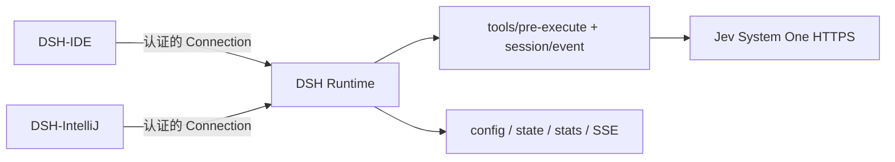

<h1 align="center">DSH Jev Integration</h1>

<p align="center">
  <strong>供 DSH-IDE 与 DSH-IntelliJ 共用的 Jev Runtime 集成。</strong><br>
</p>

<p align="center">
  <a href="README.md">English</a> | <strong>简体中文</strong>
</p>

<p align="center">
  <em>与 IDE 解耦的 DSH Runtime 集成包，不包含 VS Code UI、IntelliJ UI 或 IDE SDK。</em>
</p>

## 为什么需要这个仓库？

- **一个 Runtime 集成。** DSH-IDE 与 DSH-IntelliJ 都通过
  `vendor/dsh-jev-integration` 固定引用同一个 commit。
- **真实 Jev 调用。** 适配本地 `dsh-jev` 0.2.0 的 System One HTTP 契约，不臆造 SDK。
- **Runtime 管理状态。** 配置、最终生效状态、统计、Hooks 和订阅都属于 DSH Runtime，
  而不是某一个 IDE。
- **支持复用。** 连接已有 Runtime 前先探测；某个 IDE 断开时只释放自己的订阅，不停止共享 Runtime。

实现依据本地 DSH 源码 `../dsh-ide/deepseek-harness`，以及
`/tmp/dsh-jev-research` 中 commit `b672902` 的 Jev 源码。当前 DSH Runtime
兼容下限为 `0.1.5-rc.1`（`0.1.5` Runtime 线）。

## 快速开始

本仓库面向宿主/插件开发者。最终用户只需安装对应 IDE 插件，不需要另装
Jev IDE 插件。

要求：Node.js `>=22.19.0`、DSH Runtime `>=0.1.5-rc.1`；如需启用 Jev
增强检查，再提供 `TYPESAFE_API_KEY`。

1. 将本仓库固定到两个宿主共同选择的 commit。
2. 构建并检查：

   ```bash
   pnpm install
   pnpm build
   pnpm typecheck
   pnpm smoke
   ```

3. 将包加入 IDE 自己拥有的 DSH profile：

   ```bash
   dsh plugin --profile <profile-name> add /absolute/path/dsh-jev-integration
   ```

4. 向该 Runtime 提供 `TYPESAFE_API_KEY`，或使用已有的
   `$HOME/.dsh/.env` 约定。密钥不会通过协议返回，也不会由本包持久化。
5. 每次连接或重连先调用 `GET /api/dsh-jev/capabilities`，比较
   integration/protocol 版本、commit、Runtime 兼容范围和能力声明，最后订阅状态。

### Runtime 操作

| 需求 | 入口 |
| --- | --- |
| 检查插件是否挂载 | `GET /api/dsh-jev/capabilities` |
| 读取最终配置 | `GET /api/dsh-jev/config?workspaceId=...` |
| 只覆盖下一轮 DSH turn | `POST /api/dsh-jev/config`，`scope: "next-turn"` |
| 渲染 Runtime 实时状态 | `GET /api/dsh-jev/events?workspaceId=...` |
| 查看可测量的 Jev 调用 | `GET /api/dsh-jev/stats?workspaceId=...` |

## 核心功能

### 真实 Jev System One 适配

`runtime/src/jev-client.ts` 使用本地 `dsh-jev` 源码的真实请求格式：
`model`、字符串化的 `state`，以及真实的 `noul`/`score` questions。响应支持
`answers`、`results` 或直接答案对象，并按真实的 `noul`/`probability` 字段归一化。

默认 endpoint 为 `https://api.typesafe.ai/v1/systemone`，默认模型为
`jev-latest`。客户端读取 `TYPESAFE_API_KEY` 或 `$HOME/.dsh/.env`。本包不包含
Jev 二进制、模型权重、平台资源或 IDE 插件。

当前版本是 **minimal shared Runtime integration**，不是完整 `dsh-jev` bundle 的替代品。
除 System One advisory `tools/pre-execute` Hook 外，已经按真实 DSH 扩展点提供可选策略：

- `loopGuard`：在 `tools/post-execute` 判断语义停滞并注入一次纠偏上下文；完全相同的重复调用仍由 DSH 自带 repeat-tool reminder 负责。
- `resultShaper`：对重复且过长的文本结果做语义分类，只保留 warning/failure 行；默认关闭，因为它会改变模型看到的结果。
- `doneGate`：在 `agent/turn-stopping` 读取 Runtime 观察到的工具结果，检查助手的完成声明；证据不足时向同一轮 steer 一次验证请求。默认关闭，Jev 不可用时不会阻断轮次。
- `toolPruner`：接入真实的 `system-prompt/assemble` waterfall 和可选
  `ctx.toolPruner` 服务。只对已通过 DSH 可见性/权限筛选的 schema 做 top-K
  选择，保留必要工具和 `alwaysRetain`，记录实际的 `toolsSeen`、`toolsKept`、
  `removedChars`，不修改 ToolRuntime 权限或查找规则。
- `skillRouter`：使用真实 `ctx.skills.snapshot/list/get`，向 assembly 追加有界
  advice context；不删除用户已有 context，也不静默修改用户 prompt。
- `decisionTools`：只有显式启用后才通过 `ctx.tools.register` 注册
  `jev_ask`、`jev_rank`、`jev_check`。输入、问题、候选项、结果文本、超时和取消
  都有上限；Jev 不可用时返回结构化 unknown。
- `deterministicSafetyGuard`：通过 `ctx.tools.guard` 增加本地同步的危险命令、权限
  提升、凭据泄漏规则；它不是 DSH 最终权限判断的替代品，也不会把检查参数发给 Jev。

完整的 Jev-controlled Agent Loop、浏览器/移动端能力和 `jev_stats` 工具仍不属于本共享
集成。

### 上游 gap audit

本轮按当前 [`zhangxaochen/dsh-jev`](https://github.com/zhangxaochen/dsh-jev) 的
client、safety guard、tool pruner、skill router、result shaper、loop guard 和
decision primitives 模块逐项对照；共享 Runtime 等价能力已经补齐，同时保持显式开关、
故障降级和 DSH 权限边界。上游的 `jev_stats` UI/dashboard、benchmark/billing 辅助、
浏览器/移动端插件和 Jev-controlled Agent Loop 不复制到这里；Agent 调度、权限、工具
查找和执行仍由 DSH 负责。

### DSH Runtime Hooks 与 exact endpoints

Cordis 插件注册真实的 DSH `tools/pre-execute`、`tools/post-execute`、
`agent/pre-step`、`agent/turn-stopping` Hook，以及处理一次性 next-turn 覆盖的持久
`session/event` Hook。通信沿用 DSH Connection exact Fetch，不另建 RPC 或 WebSocket 栈。

提供的端点为：

- `GET /api/dsh-jev/capabilities`
- `GET`、`POST /api/dsh-jev/config`
- `GET /api/dsh-jev/state`
- `GET /api/dsh-jev/stats`
- `POST /api/dsh-jev/stats/reset`
- `GET /api/dsh-jev/events`（SSE）

DSH 的 exact Fetch registry 当前支持 GET/HEAD/POST，因此配置更新使用 POST，
而不是臆造 PUT endpoint。

### 可选、故障降级的增强检查

Jev 是增强能力，不替代 DSH 自己的权限和安全策略。缺少密钥、超时、取消、网络/HTTP
错误和格式错误都会被计数并暴露在 Runtime 状态中，然后继续正常的
DSH 工具流程。只有 Jev 返回有效风险结果时，才按阈值返回 `ask` 或 `deny`；
无界面 session 如何处理 `ask` 由宿主/DSH Runtime 决定。

由于启用后会把受保护工具的完整参数发送到配置的 TypeSafe endpoint，集成默认关闭；
宿主应先展示隐私提示，再在选定 scope 显式写入 `enabled: true`。临时的 timeout、
network、429 或 5xx 错误最多重试一次；格式错误和永久 HTTP 错误不会重试。

### 共享状态与生命周期

插件在一个 Runtime 作用域内幂等，避免重复注册 Hooks、routes 和统计。支持 IDE
启动的新 Runtime、连接已有 Runtime、两个 IDE 同时连接、断开/重连以及插件卸载/重挂载。
不会向宿主不拥有的 Runtime 动态挂载、重启或写入配置。

## 架构与运行机制



目录职责：

```
dsh-jev-integration/
  runtime/       Cordis 插件、Jev client、Hooks、持久化、端点
  protocol/      JSON Schema、TypeScript 声明、Kotlin 消费模型
  scripts/       可重复构建和非单元测试冒烟命令
  examples/      TypeScript/Kotlin 最小宿主调用
```

当前 protocol 版本为 `1.1`，integration 版本为 `0.1.0`。相对 `1.0`，`1.1`
增加了必需的策略配置、统计和 capability 字段；严格的 `1.0` 客户端应拒绝它并先
升级宿主。构建时可通过 `DSH_JEV_INTEGRATION_COMMIT` 注入 commit；未注入的本地构建
返回 `unresolved`，不会伪造 hash。宿主应自行固定并比较 Git commit。

## 配置与状态

完整协议见 [`protocol/README.md`](protocol/README.md)。配置优先级从低到高为：

1. 内置默认值；
2. Runtime composition/startup patch；
3. 持久化全局值；
4. 持久化 workspace 值；
5. 内存 session 值；
6. 内存一次性 next-turn 值。

当值来自 Runtime composition patch 时，`effective.source`（以及配置响应的
`source`）会是 `startup`。它是只读的部署级来源；GET 响应为了保持可写 scope 的形状
返回 `scope: "global"`，但会正确返回 `persisted: false`。只有显式 POST 到 global 或
workspace scope 才会写入集成层持久化文件。

| 配置项 | 默认值 | 说明 |
| --- | ---: | --- |
| `enabled` | `false` | 用户显式请求启用 Jev；启用后可能向 TypeSafe 发送受保护工具参数。 |
| `baseUrl` | `https://api.typesafe.ai/v1/systemone` | TypeSafe System One endpoint。 |
| `model` | `jev-latest` | 每次请求发送的 Jev 模型名。 |
| `timeoutMs` | `2000` | 一般 client 超时。 |
| `advisoryTimeoutMs` | `3500` | pre-execute 有界增强检查预算，与 dsh-jev semantic inspection 一致。 |
| `askThreshold` | `0.50` | 风险概率达到此值时请求批准。 |
| `blockThreshold` | `0.85` | 风险概率达到此值时返回 deny。 |
| `loopGuard.enabled` | `false` | 启用 post-execute 语义停滞提示。 |
| `resultShaper.enabled` | `false` | 启用重复文本结果的语义整形。 |
| `doneGate.enabled` | `false` | 启用轮次结束前的完成证据检查。 |
| `toolPruner.enabled` | `false` | 启用模型 schema 的 top-K 裁剪；必要工具和 `alwaysRetain` 始终保留。 |
| `skillRouter.enabled` | `false` | 启用最多 `maxSkills` 条 skill advice context。 |
| `decisionTools.enabled` | `false` | 启用 `jev_ask`、`jev_rank`、`jev_check`；模型提供的 state 会发送到 Jev。 |
| `deterministicSafetyGuard.enabled` | `true` | DSH 提供 `tools.guard` 时启用本地同步 deny 规则，不调用 Jev。 |

三个嵌套策略对象还包含各自的阈值和有界预算。宿主只更新其中一个字段时，Runtime
会对嵌套配置做深合并，不会静默覆盖同一策略的其他默认值。所有策略复用同一个 Jev
endpoint、超时/取消处理和一次有界瞬时错误重试，并在 Jev 不可用时降级放行；确定性
guard 则只在本地同步执行。统计包含跳过、低置信度、fail-open、延迟以及可测量的裁剪/
advice 计数；没有 `toolPrunerToolsSeen`、`toolPrunerToolsKept` 或
`toolPrunerRemovedChars` 时不会宣称节省 Token。

Runtime 状态会明确区分：

- `userRequested.enabled`：最高优先级调用者的意愿；
- `effective.enabled`、`effective.values`：Runtime 计算出的最终配置；
- `available`、`availabilityReason`：最新已知 Jev 可用性；
- `executing`、`activeRequests`：当前正在执行的 Jev 请求。

capabilities 探测不会主动请求外部 health endpoint。首次调用前，available 表示
已配置凭据；调用后还会反映最近一次上游结果。

## 协议与宿主接入

成功响应为 `{ "ok": true, "data": ... }`；失败响应为
`{ "ok": false, "error": ... }`，使用稳定的 `DJE-*` 错误码。SSE 端点把
state/config/stats 事件作为 `data:` JSON 发送。

TypeScript：

```ts
import type { CapabilitiesResponse, ConfigUpdateRequest } from 'dsh-jev-integration/protocol'

const capabilities = await fetch(`${runtimeBase}/api/dsh-jev/capabilities`).then(r => r.json()) as {
  ok: true; data: CapabilitiesResponse
}
if (capabilities.data.protocolVersion !== '1.1' || !capabilities.data.pluginMounted) {
  throw new Error('DSH Jev integration is missing or incompatible')
}

const update: ConfigUpdateRequest = {
  workspaceId: dshWorkspaceId,
  scope: 'next-turn',
  patch: { enabled: true },
}
await fetch(`${runtimeBase}/api/dsh-jev/config`, {
  method: 'POST',
  headers: { 'content-type': 'application/json' },
  body: JSON.stringify(update),
})

const events = new EventSource(
  `${runtimeBase}/api/dsh-jev/events?workspaceId=${encodeURIComponent(dshWorkspaceId)}`,
)
events.onmessage = event => renderRuntimeState(JSON.parse(event.data))
```

完成 capabilities 探测后，拥有该 Runtime 的宿主可以通过同一个 endpoint 显式开启共享能力，
不需要另建通信栈：

```ts
await fetch(`${runtimeBase}/api/dsh-jev/config`, {
  method: 'POST',
  headers: { 'content-type': 'application/json' },
  body: JSON.stringify({
    workspaceId: dshWorkspaceId,
    scope: 'workspace',
    patch: {
      enabled: true,
      toolPruner: { enabled: true, maxTools: 8 },
      skillRouter: { enabled: true, maxSkills: 2 },
      decisionTools: { enabled: true },
    },
  }),
})
// Runtime 自己挂载 system-prompt/assemble、ctx.toolPruner、ctx.skills 和
// ctx.tools.register/guard；IDE 只展示 capabilities/state。
```

连接已有 Runtime 时，宿主必须先确认对应 capability 为 true。缺少
`tools.register`、`tools.guard` 或 skill service 时会返回不可用/降级结果；宿主不应重启
或修改自己不拥有的 Runtime。

Kotlin 消费方可使用附带的
[`JevIntegrationProtocol.kt`](protocol/kotlin/src/main/kotlin/ai/deepseek/dsh/jev/JevIntegrationProtocol.kt)
和 `kotlinx.serialization`；完整宿主形状示例见
[`examples/kotlin-host.kt`](examples/kotlin-host.kt)。

## 构建与分发

```bash
pnpm install
pnpm build              # 编译 TypeScript，并把 schema/patch 复制到 dist/
pnpm typecheck          # strict TypeScript 检查
pnpm smoke              # mount/route/hook/SSE 集成冒烟
pnpm pack:check         # 检查 npm tarball 内容
```

也可以使用 `npm`。已提交的 `dist/` 目录包含：

- `dist/runtime/src/index.js` 及声明：Runtime 入口；
- `dist/runtime/cordis.patch.yml`：DSH bundle patch；
- `dist/protocol/src/`：TypeScript 协议消费端；
- `dist/protocol/schema/`：已打包 JSON Schema。

tarball 还包含 Kotlin 模型、README、MIT license 和第三方声明；除 HTTPS
System One 服务外没有额外的 Jev runtime 依赖。

## 开发与验证

当前 checkout 已验证：

```bash
npm run typecheck       # PASS
npm run build           # PASS
npm run smoke           # PASS
npm run pack:check      # PASS
node -e "JSON.parse(require('fs').readFileSync('protocol/schema/jev-integration.schema.json', 'utf8'))"  # PASS
git diff --check        # PASS
```

冒烟命令使用 fake Connection、DSH service、skill catalog、tool registry/guard 和 fake HTTP
response，验证真实请求/响应形状、挂载生命周期、状态、配置、SSE、deny 决策、
post-execute loop guard/result shaper、turn-stopping 完成证据 gate、tool pruning、skill
advice、三个 decision tool、本地危险命令规则、嵌套配置深合并和 next-turn 消费；不会
使用现有 Session 或外部模型凭据。

JSON Schema 和 `protocol/examples/capabilities.json` 均已成功 parse。Kotlin 源码已提供给
消费方，但当前环境没有 `kotlinc`，因此未编译。真实 TypeSafe 请求、IDE 远程认证和付费
Token benchmark 仍未验证。

另外，在隔离的临时 `DSH_HOME` 中把本包链接到本机 DSH web profile，启动真实进程，
完成 browser-token exchange，并通过真实 Connection 读取了
`GET /api/dsh-jev/capabilities`。该 CLI 报告版本为 `0.1.5-rc.1`，正是本包支持的
`0.1.5` Runtime 线兼容下限。真实 TypeSafe 请求、IDE 远程认证和 Kotlin 编译（当前
环境没有 `kotlinc`）仍未验证。
本仓库不添加单元测试，也不修改 DSH-IDE、DSH-IntelliJ、全局 DSH 配置或真实用户会话。

## 常见问题

**需要安装 Jev IDE 插件吗？** 不需要。IDE 插件只负责把本包挂到 Runtime 并消费协议；
Runtime 负责向 System One 发 HTTPS 请求。

**没有 API key 时会怎样？** 默认请求状态是 `enabled=false`。如果宿主显式启用但没有
密钥，Runtime 返回 `available=false` 和 `missing-api-key`，跳过增强检查，正常继续 DSH。

**可以连接已有或远程 Runtime 吗？** 可以，但必须先探测 capabilities。若端点缺失或
不兼容，宿主应展示明确结果，并让 Runtime 拥有者挂载兼容版本。本包不会假设外部 Runtime
支持动态挂载，也不会擅自重启或改写它。

**`workspaceId` 指什么？** 它是 DSH Runtime 通过 `session.header.cwd` 和
`workspaceRegistry` 解析出的 DSH Workspace identity，不是 IDE 工程目录 ID。

**配置保存在哪里？** 全局和 workspace 配置保存在 `$DSH_HOME/jev-integration/`
（`config.json` 与 `stats.json`）；`DSH_JEV_INTEGRATION_HOME` 是显式的测试/部署覆盖目录。
session 和 next-turn 覆盖只在内存中存在。

## 更多信息

- [协议说明](protocol/README.md)
- [TypeScript 宿主示例](examples/typescript-host.ts)
- [Kotlin 宿主示例](examples/kotlin-host.kt)
- [第三方声明](THIRD_PARTY_NOTICES.md)
- [许可证](LICENSE)

固定 commit 前，请 review 协议优先级、headless `ask` 处理方式、`enabled=true` 的隐私
提示，以及 minimal integration 功能范围是否符合两个宿主的设置页语义。
